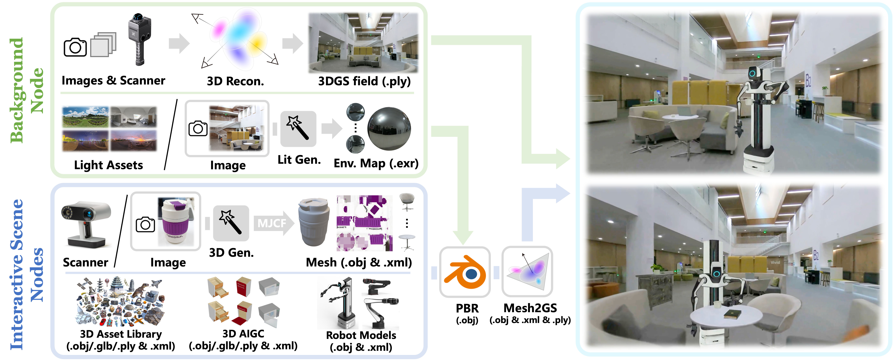

# DISCOVERSE: Efficient Robot Simulation in Complex High-Fidelity Environments

<div align="center">

[](https://arxiv.org/abs/2507.21981)
[](https://air-discoverse.github.io/)
[](LICENSE)
[](#docker快速开始)

https://github.com/user-attachments/assets/78893813-d3fd-48a1-8bb4-5b0d87bf900f

*基于3DGS的统一、模块化、开源Real2Sim2Real机器人学习仿真框架*

</div>

<div align="center">
<h1>
🎉 DISCOVERSE被IROS 2025接收！
</h1>
</div>

我们的论文《DISCOVERSE: Efficient Robot Simulation in Complex High-Fidelity Environments》已被IEEE/RSJ International Conference on Intelligent Robots and Systems (IROS) 2025接收。


## 📦 安装与快速开始

### 快速开始

1. 克隆仓库
```bash
# 安装Git LFS (如果尚未安装)
## Linux
curl -s https://packagecloud.io/install/repositories/github/git-lfs/script.deb.sh | sudo bash
sudo apt-get install git-lfs

## macos 使用 Homebrew
brew install git-lfs

git clone https://github.com/TATP-233/DISCOVERSE.git
cd DISCOVERSE
```

2. 选择安装方式
```bash
conda create -n discoverse discoverse python=3.10 # >=3.8即可
conda activate discoverse
pip install -e .

## 自动检测并下载需要 submodules
python scripts/setup_submodules.py

## 验证安装
python scripts/check_installation.py
```

### 按需求选择安装 

#### 场景1: 学习机器人仿真基础
```bash
pip install -e .  # 仅核心功能
```
**包含**: MuJoCo、OpenCV、NumPy等基础依赖

#### 场景2: 激光雷达SLAM
```bash
pip install -e ".[lidar,visualization]"
```
- **包含**: Taichi GPU加速、LiDAR仿真、可视化工具
- **功能**: 高性能LiDAR仿真，基于Taichi GPU加速
- **依赖**: `taichi>=1.6.0`
- **适用**: 移动机器人SLAM、激光雷达传感器仿真、点云处理

#### 场景3: 机械臂模仿学习
```bash
pip install -e ".[act_full]"
```
- **包含**: ACT算法、数据收集工具、可视化
- **功能**: 模仿学习、机器人技能训练、策略优化
- **依赖**: `torch`, `einops`, `h5py`, `transformers`, `wandb`
- **算法**：其他算法可选[diffusion-policy]和[rdt]"

#### 场景4: 高保真视觉仿真
```bash
pip install -e ".[gaussian-rendering]"
```
- **包含**: 3D高斯散射、PyTorch
- **功能**: 逼真的3D场景渲染，支持实时光照
- **依赖**: `torch>=2.0.0`, `torchvision>=0.14.0`, `plyfile`, `PyGlm`
- **适用**: 高保真视觉仿真、3D场景重建、Real2Sim流程

### 模块功能速览

| 模块 | 安装命令 | 功能 | 适用场景 |
|------|----------|------|----------|
| **基础** | `pip install -e .` | 核心仿真功能 | 学习、基础开发 |
| **激光雷达** | `.[lidar]` | 高性能LiDAR仿真 | SLAM、导航研究 |
| **渲染** | `.[gaussian-rendering]` | 3D高斯散射渲染 | 视觉仿真、Real2Sim |
| **GUI** | `.[xml-editor]` | 可视化场景编辑 | 场景设计、模型调试 |
| **ACT** | `.[act]` | 模仿学习算法 | 机器人技能学习 |
| **扩散策略** | `.[diffusion-policy]` | 扩散模型策略 | 复杂策略学习 |
| **RDT** | `.[rdt]` | 大模型策略 | 通用机器人技能 |
| **硬件集成** | `.[hardware]` | RealSense+ROS | 真实机器人控制 |

### Docker快速开始

我们提供了docker安装方式。

#### 1. 安装NVIDIA Container Toolkit：
```bash
# 设置软件源
distribution=$(. /etc/os-release;echo $ID$VERSION_ID) \
    && curl -s -L https://nvidia.github.io/nvidia-docker/gpgkey | sudo apt-key add - \
    && curl -s -L https://nvidia.github.io/nvidia-docker/$distribution/nvidia-docker.list | sudo tee /etc/apt/sources.list.d/nvidia-docker.list

# 更新并安装
sudo apt-get update
sudo apt-get install -y nvidia-container-toolkit nvidia-docker2

# 重启Docker服务
sudo systemctl restart docker
```

#### 2. 构建Docker镜像

- 下载预构建Docker镜像
  
    百度网盘：https://pan.baidu.com/s/1mLC3Hz-m78Y6qFhurwb8VQ?pwd=xmp9
    
    目前更新至v1.8.6，下载.tar文件之后，使用docker load指令加载docker image
    
    将下面的`discoverse_tag.tar`替换为实际下载的镜像tar文件名。

    ```bash
    docker load < discoverse_tag.tar
    ```

- 或者 从`docker file`构建
    ```bash
    git clone https://github.com/TATP-233/DISCOVERSE.git
    cd DISCOVERSE
    python scripts/setup_submodules.py --module gaussian-rendering
    docker build -f docker/Dockerfile -t discoverse:latest .
    ```
    `Dockerfile.vnc`是支持 VNC 远程访问的配置版本。它在`docker/Dockerfile`的基础上添加了 VNC 服务器支持，允许你通过 VNC 客户端远程访问容器的图形界面。这对于远程开发或在没有本地显示服务器的环境中特别有用。如果需要，将`docker build -f docker/Dockerfile -t discoverse:latest .`改为`docker build -f docker/Dockerfile.vnc -t discoverse:latest .`


#### 3. 创建Docker容器

```
# 使用GPU支持运行
docker run -dit --rm --name discoverse \
    --gpus all \
    -e DISPLAY=$DISPLAY \
    -v /tmp/.X11-unix:/tmp/.X11-unix \
    discoverse:latest
# 注意：把`latest`修改成实际的docker image tag (例如v1.8.6)。

# 设置可视化窗口权限
xhost +local:docker

# 进入容器终端
docker exec -it discoverse bash

# 测试运行
python3 discoverse/examples/active_slam/camera_view.py
```


## 📷 高保真渲染设置

用于高保真3DGS渲染功能，若无高保真渲染需求或者通过docker安装的用户，可跳过这一章节。

### 1. CUDA安装
从[NVIDIA官网](https://developer.nvidia.com/cuda-toolkit-archive)安装CUDA 11.8+，根据自己的显卡驱动选择对应的cuda版本。

### 2. 3DGS依赖
```bash
# 安装gaussian splatting依赖
pip install -e ".[gaussian-rendering]"

# 构建diff-gaussian-rasterization
cd submodules/diff-gaussian-rasterization/

# 应用补丁
sed -i 's/(p_view.z <= 0.2f)/(p_view.z <= 0.01f)/' cuda_rasterizer/auxiliary.h
sed -i '361s/D += depths\[collected_id\[j\]\] \* alpha \* T;/if (depths[collected_id[j]] < 50.0f)\n        D += depths[collected_id[j]] * alpha * T;/' cuda_rasterizer/forward.cu

# 安装
cd ../..
pip install submodules/diff-gaussian-rasterization
```

### 3. 下载3dgs模型

- [百度网盘](https://pan.baidu.com/s/1y4NdHDU7alCEmjC1ebtR8Q?pwd=bkca) 
- [清华云盘](https://cloud.tsinghua.edu.cn/d/0b92cdaeb58e414d85cc/)

.ply模型文件较大，选择自己需要的模型即可。

放在`models/3dgs`目录，如下：
```
models/
├── meshes/          # 网格几何
├── textures/        # 材质纹理  
├── 3dgs/           # 高斯散射模型
│   ├── airbot_play/
│   ├── mmk2/
│   ├── objects/
│   ├── scenes/
│   └── ......
├── mjcf/           # MuJoCo场景描述
└── urdf/           # 机器人描述
```

### 3. 模型可视化
使用[SuperSplat](https://playcanvas.com/supersplat/editor)在线查看和编辑3DGS模型 - 只需拖放`.ply`文件。

## 🔨 Real2Sim管道



DISCOVERSE具有全面的Real2Sim管道，用于创建真实环境的数字孪生。详细说明请访问我们的[Real2Sim仓库](https://github.com/GuangyuWang99/DISCOVERSE-Real2Sim)。

## 💡 使用示例

### 基础机器人仿真
```bash
# 启动Airbot Play / MMK2
python discoverse/robots_env/airbot_play_base.py
python discoverse/robots_env/mmk2_base.py

# 运行操作任务（自动数据生成）
python discoverse/examples/tasks_airbot_play/place_coffeecup.py
python discoverse/examples/tasks_mmk2/kiwi_pick.py

# 触觉手 leaphand
python discoverse/examples/robots/leap_hand_env.py

# 逆向运动学
python discoverse/examples/mocap_ik/mocap_ik_airbot_play.py # 可选 [--mjcf mjcf/tasks_airbot_play/stack_block.xml]
python discoverse/examples/mocap_ik/mocap_ik_mmk2.py # 可选 [--mjcf mjcf/tasks_mmk2/pan_pick.xml]
```

https://github.com/user-attachments/assets/6d80119a-31e1-4ddf-9af5-ee28e949ea81

### 交互式控制
- **'h'** - 显示帮助菜单
- **'F5'** - 重新加载MJCF场景
- **'r'** - 重置仿真状态
- **'['/'']'** - 切换相机视角
- **'Esc'** - 切换自由相机模式
- **'p'** - 打印机器人状态信息
- **'Ctrl+g'** - 切换高斯渲染（需安装gaussian-splatting并制定cfg.use_gaussian_renderer = False）
- **'Ctrl+d'** - 切换深度可视化

## 🎓 学习与训练

### 模仿学习快速开始

DISCOVERSE提供数据收集、训练和推理的完整工作流：

1. **数据收集**：[指南](./doc/imitation_learning/data.md)
2. **模型训练**：[指南](./doc/imitation_learning/training.md) 
3. **策略推理**：[指南](./doc/imitation_learning/inference.md)

### 支持的算法
- **ACT**
- **Diffusion Policy** 
- **RDT**
- **自定义算法**通过可扩展框架

## ⏩ 最近更新

- **2025.01.13**：🎉 DISCOVERSE开源发布
- **2025.01.16**：🐳 添加Docker支持
- **2025.01.14**：🏁 [S2R2025竞赛](https://sim2real.net/track/track?nav=S2R2025)启动
- **2025.02.17**：📈 集成Diffusion Policy基线
- **2025.02.19**：📡 添加点云传感器支持

## 🤝 社区与支持

<div align="center">


*加入我们的微信社区获取更新和讨论*
</div>

## ❔ 故障排除

有关安装和运行时问题，请参考我们详细的**[故障排除指南](doc/troubleshooting.md)**。

## ⚖️ 许可证

DISCOVERSE在[MIT许可证](LICENSE)下发布。详细信息请参见许可证文件。

## 📜 引用

如果您发现DISCOVERSE对您的研究有帮助，请考虑引用我们的工作：

```bibtex
@article{jia2025discoverse,
    title={DISCOVERSE: Efficient Robot Simulation in Complex High-Fidelity Environments},
    author={Yufei Jia and Guangyu Wang and Yuhang Dong and Junzhe Wu and Yupei Zeng and Haonan Lin and Zifan Wang and Haizhou Ge and Weibin Gu and Chuxuan Li and Ziming Wang and Yunjie Cheng and Wei Sui and Ruqi Huang and Guyue Zhou},
    journal={arXiv preprint arXiv:2507.21981},
    year={2025},
    url={https://arxiv.org/abs/2507.21981}
}
```